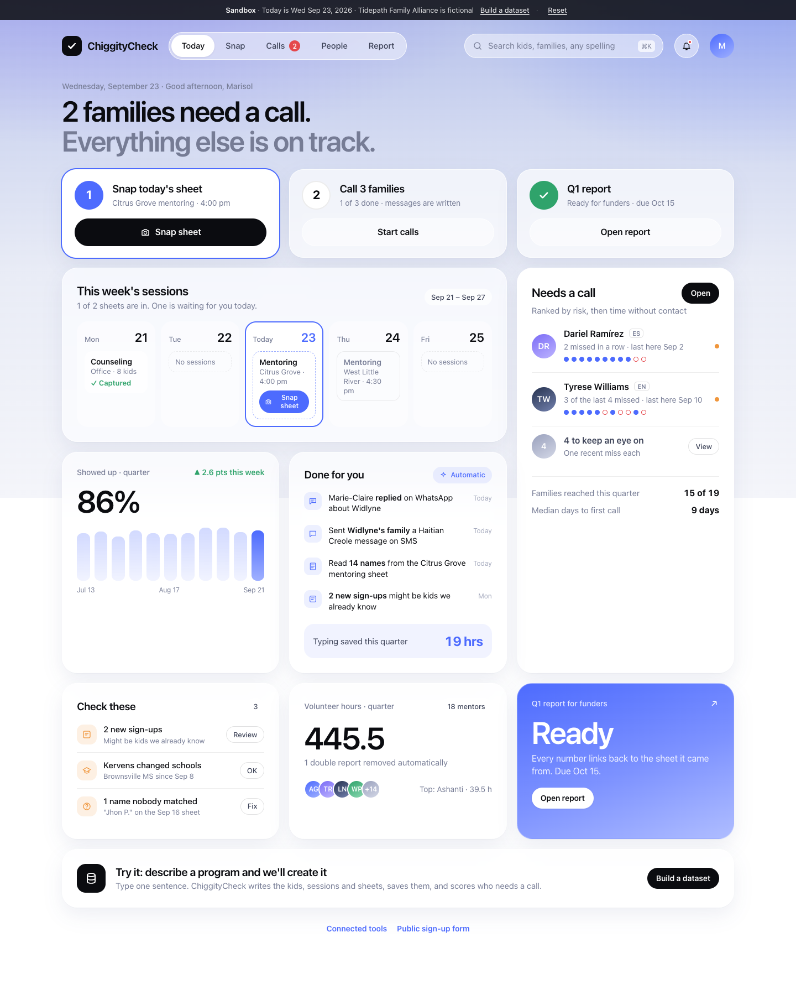
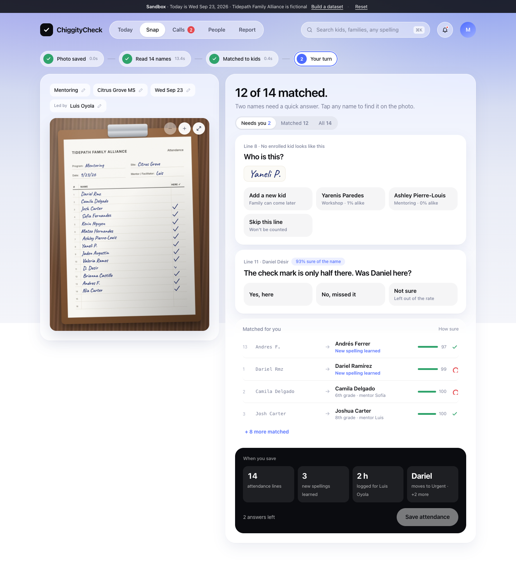
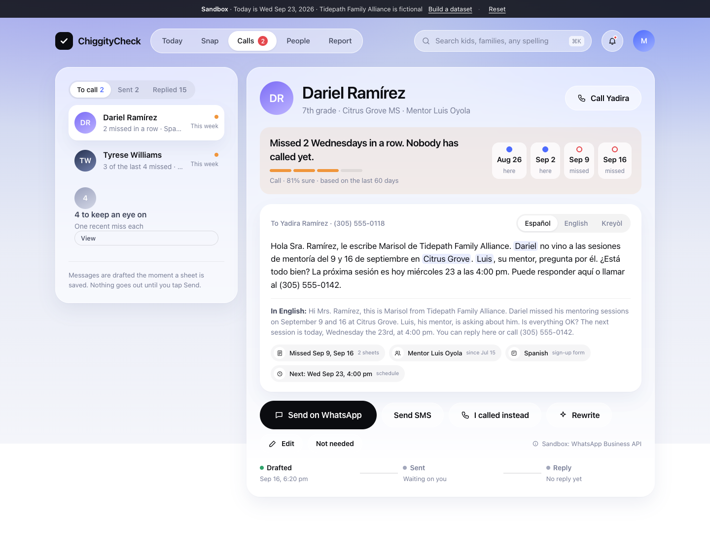
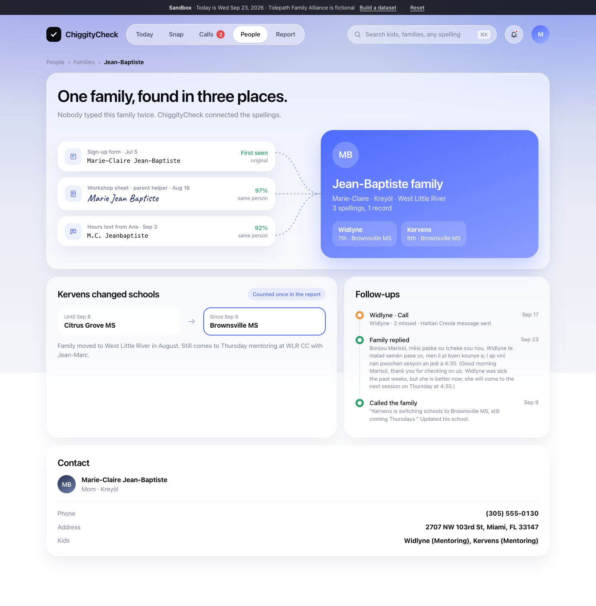
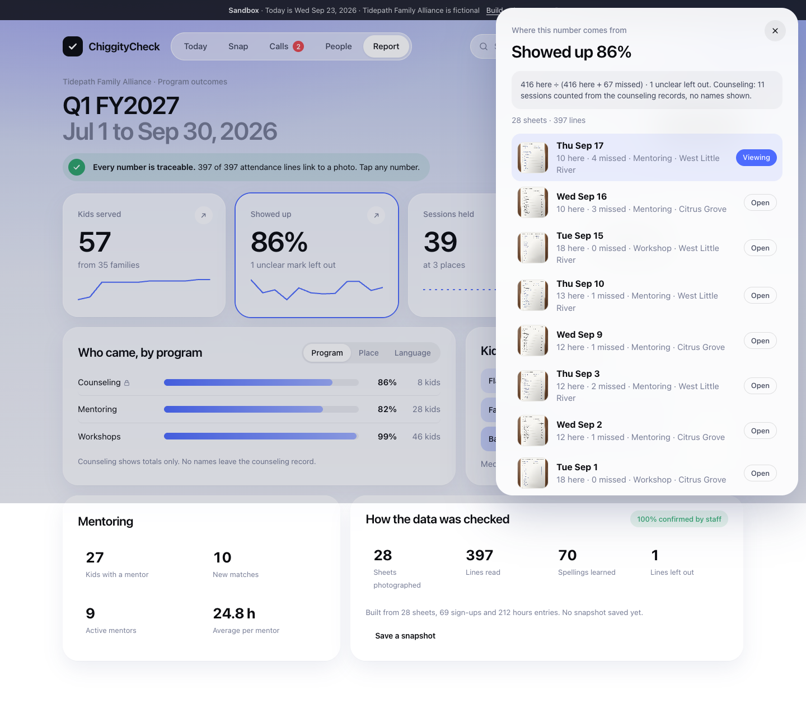

# AttendClear

**Snap the sign-in sheet. Everything else is done.**

AttendClear reads the paper attendance sheet that youth-program mentors already fill in, matches every handwritten name to the right kid, tells staff which families to call this week (with the message already written in the family's language), and keeps the funder's quarterly report finished. Every number in the report opens the photo it came from.

**Live:** https://attendclear.com (also https://check.micahberkley.com) · Built for the Give Miami Day Hackathon 2026 (The Miami Foundation), challenge 1 "From sign-up to quarterly report". The nonprofit, Tidepath Family Alliance, is fictional: a composite of 14 real South Florida nonprofits.



## The problem

Marisol runs every program at Tidepath. Her words: *"Every week I copy new sign-ups from our online form into the program spreadsheet and type in attendance from the paper sheets. The same mother can be on three lists, spelled three ways. Last month a kid missed three sessions before anyone called home, because the attendance sheets weren't typed in yet. Every quarter, the outcome report takes me about 3 days, and the numbers never match the first time."*

## What it does

| Step | What happens |
|---|---|
| **Snap** | One photo of the paper sheet. A vision model reads every handwritten name and check mark. |
| **Match** | Each spelling is matched to an enrolled kid with a probability. Spellings are learned forever, so "Dariel Rmz", "D. Ramirez" and "Dariel Ramírez" are one kid. New kids and unclear marks are asked about, nothing else. |
| **Call** | After every save, each kid's attendance pattern is scored. Two misses in a row flags the family. The message is drafted in Spanish, Haitian Creole or English from the real facts only, and sent on WhatsApp (sandbox). |
| **Prove** | The quarterly report is computed live from the records. Every figure has an evidence drawer: the sessions and lines behind it, with the sheet photo and the line highlighted. |






## It is a real app, not a slideshow

- **Edit anything and watch it ripple.** Flip one attendance square on a kid's profile and the app reports what else moved: the kid's rate and risk level, the calls count, the report. The same for a kid's name or school, or a family's phone or language (open drafts are rewritten in the new language).
- **Build a dataset from a sentence.** Type "Add a Saturday soccer program at Miami Jackson with 12 kids for 6 weeks, three are slipping" and the model writes the families, kids, sessions, attendance and hours, the server validates and saves them, and the follow-up engine scores them. About 20 seconds.
- **Public sign-up form** (`/signup`). Every submission is matched to existing families and kids before it is saved, so "Josh Carter" links to the enrolled Joshua Carter instead of creating a duplicate. A CSV import does the same for a whole spreadsheet.
- **Reset** in the banner puts the demo back to Wednesday, Sep 23, 2026 in under a second.

## Out of the box

- **Cloudflare AI Gateway** (`chiggitycheck`) logs every Workers AI vision read. OpenAI models are called directly with your OpenAI key.

- **Cloudflare Workers AI** reads the sheet (`@cf/mistralai/mistral-small-3.1-24b-instruct`, with Moondream and OpenAI vision as fallbacks).
- **OpenAI Decisions API** (`gpt-6-luna`) answers up to 400 typed questions per call: one predicate per (handwritten row, candidate kid), a second look at every doubtful check mark with the photo attached, a severity score and language choice per kid, and sign-up resolution. The exact request shape:

```json
{
  "model": "gpt-6-luna",
  "input": [{ "role": "user", "content": [
    { "type": "input_image", "image_url": "data:image/jpeg;base64,..." },
    { "type": "input_json", "data": { "sheet": {...}, "rows": [...], "candidates": [...] } }
  ] }],
  "questions": [
    { "type": "predicate", "name": "r1_k1", "instructions": "Is handwritten row R1 (\"Dariel Rmz\") the same child as kid K1?" },
    { "type": "choice", "name": "m11", "instructions": "What is in row 11's HERE box?", "choices": [{ "value": "present", "description": "A complete check mark" }, ...] },
    { "type": "score", "name": "sev_1", "instructions": "How urgently should staff contact this family?", "levels": [{ "label": "Fine", "description": "..." }, ...] }
  ]
}
```

- **gpt-5.5** drafts every family message from a JSON fact list, returns a translation and the exact substrings that came from the facts (highlighted in the UI), and plays the parent in the WhatsApp sandbox.
- **Provenance chain:** every attendance line keeps its photo, row index and bounding box, so a report figure opens the exact line on the exact sheet.

## Architecture

```
 Phone / laptop ──► Cloudflare Worker (Hono)
                      ├─ /api/sheets/*     photo → R2 → Workers AI vision → candidates (code) → Decisions API → confirm
                      ├─ /api/followups/*  score (Decisions) → draft (gpt-5.5) → WhatsApp/SMS sandbox → webhooks → reply
                      ├─ /api/signups      web form / CSV → Decisions API → link or create
                      ├─ /api/report/*     computed live from D1, evidence per figure
                      ├─ /api/scenarios    typed request → gpt-5.5 dataset → validated → saved → scored
                      └─ /api/attendance, /api/kids, /api/families  edits → ripple diff
                      D1 (SQLite): families, kids, sessions, attendance, aliases, hours, followups, messages, signups, ai_calls
                      R2: uploaded photos      Assets: React app + 29 sheet photos
 React 19 + Vite 8 app: Today, Snap, Calls, People, Report, Lab, Integrations, Sign-up, Stage explainer
```

## The planted traps

| Trap | How the product handles it |
|---|---|
| Marie-Claire Jean-Baptiste appears as "Marie-Claire Jean-Baptiste" (form), "Marie Jean Baptiste" (sheet) and "M.C. Jeanbaptiste" (hours text) | One family record with three spellings and their sources. `People → Families → Jean-Baptiste`. |
| Dariel Ramírez misses Sep 9, 16 and 23, written "Dariel Rmz", "D. Ramirez", "Dariel Ramírez" | Matched at 0.99 each time; third miss moves him to Urgent; Spanish draft cites the three dates and his mentor Luis. |
| Kervens changes school mid-quarter | School history kept, still attends Thursday mentoring, counted once in the report. |
| Luis reports the Sep 16 session twice (text, then form) | Second report marked "Reported twice, counted once". Ana's co-lead hours stay counted. |
| "Yaneli P." is not enrolled; one half check mark | "New kid?" with a create action; "Was Daniel here?" with Yes / No / Not sure. |
| A sign-up for "Josh Carter" duplicates the enrolled "Joshua Carter" | Linked at 0.99 to the existing kid. |

## Run locally

```bash
npm install
cp .dev.vars.example .dev.vars        # add your OpenAI key
npm run seed                          # builds the quarter, renders 29 sheets (real photos from sheets/real win), compiles the reset SQL
npx wrangler d1 migrations apply chiggitycheck --local
npm run dev                           # http://localhost:5173, then POST /api/demo/reset once
```

Deploy: `npm run deploy`, then `npx wrangler d1 migrations apply chiggitycheck --remote`, `tr -d '\n' < key | npx wrangler secret put OPENAI_API_KEY`, and `POST /api/demo/reset`.

## Demo-only parts

WhatsApp, SMS, Mailchimp, QuickBooks and the donor CRM run against a sandbox that mirrors each service's API (message ids, delivery and read receipts by webhook, a simulated parent reply written by the model). No real phone or inbox is ever contacted, and the UI says so. The CSV, calendar and message-log exports are real files.

## License

MIT. Copyright (c) 2026 Micah Berkley. All people and the nonprofit in the data are fictional.
